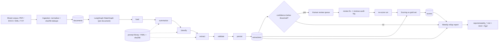
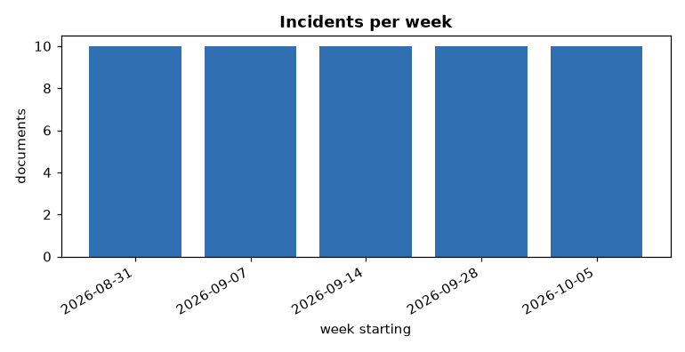
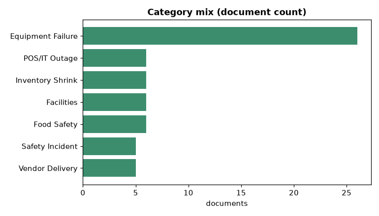
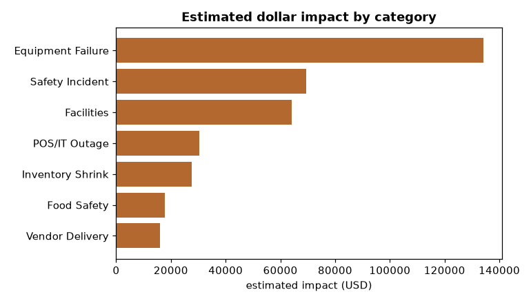
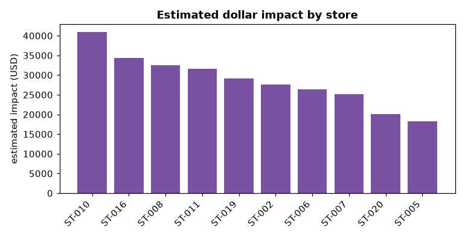
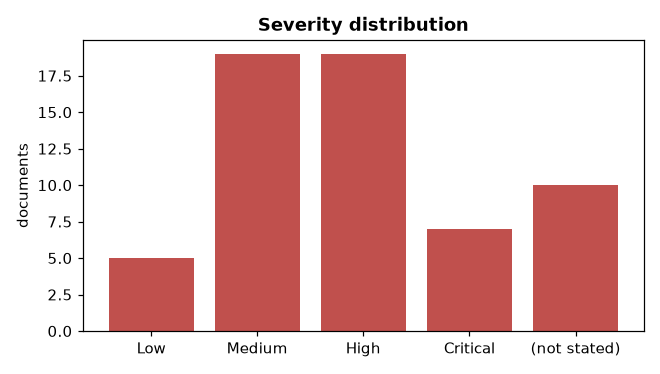
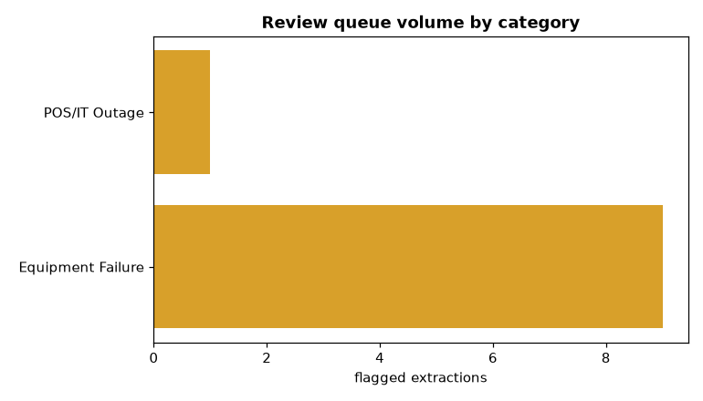
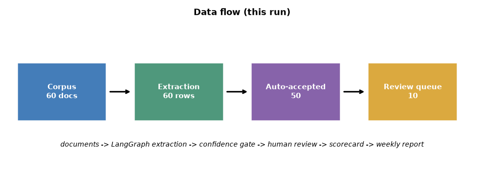

# Weekly Operations Rollup — `run-001`

_Generated 2026-10-15 07:34:33 UTC · 6-week window · 2026-08-31 to 2026-10-11_

## Executive summary

OpsReportAgent processed 60 operations documents across 6 weeks (2026-08-31 to 2026-10-11), with a total estimated dollar impact of 390,133.03. The highest-volume category was Equipment Failure with 18 incidents and 134,236.24 of estimated impact. Store ST-010 carried the largest single-store impact at 40,889.73. Severity mix: High 19, Medium 19, (not stated) 10, Critical 7, Low 5. 10 extraction(s) fell below the confidence threshold and were routed to the human review queue.

**Highlights**

- 60 documents processed over 6 weeks
- Equipment Failure: 18 incidents, 134,236.24 impact
- Top vendor by volume: Vertex Mechanical (5 documents)
- Highest-impact store: ST-010 (40,889.73)
- 390,133.03 total estimated impact
- 10 extraction(s) flagged for human review

## Headline metrics

| metric | value |
| --- | ---: |
| documents processed | 60 |
| total estimated dollar impact | 390,133.03 |
| flagged for human review | 10 |
| review rate | 16.7% |
| distinct stores | 18 |
| distinct vendors | 19 |

## Pipeline architecture



## Documents by format

| format | documents |
| --- | ---: |
| docx | 20 |
| eml | 20 |
| pdf | 20 |

## Charts

### Incidents per week



### Category mix (document count)



### Estimated dollar impact by category



### Estimated dollar impact by store



### Severity distribution



### Review queue volume by category



### Data flow (this run)




## Aggregates

### Documents by category

| category | documents | estimated impact |
| --- | ---: | ---: |
| Equipment Failure | 18 | 134,236.24 |
| Food Safety | 8 | 20,998.83 |
| Facilities | 7 | 64,103.70 |
| Inventory Shrink | 7 | 37,241.11 |
| Safety Incident | 7 | 81,113.01 |
| Vendor Delivery | 7 | 20,159.59 |
| POS/IT Outage | 6 | 32,280.55 |

### Incidents per week

| week starting | documents |
| --- | ---: |
| 2026-08-31 | 10 |
| 2026-09-07 | 10 |
| 2026-09-14 | 10 |
| 2026-09-21 | 10 |
| 2026-09-28 | 10 |
| 2026-10-05 | 10 |

### Severity distribution

| severity | documents |
| --- | ---: |
| (not stated) | 10 |
| Critical | 7 |
| High | 19 |
| Low | 5 |
| Medium | 19 |

### Top vendors by document volume

| vendor | documents |
| --- | ---: |
| Aegis Compliance Supply | 5 |
| Ironwood Facilities | 5 |
| Sentinel Audit Group | 5 |
| Vertex Mechanical | 5 |
| BluePeak Logistics | 4 |
| GreenLeaf Produce | 4 |
| Harbor Dairy Co | 4 |
| Sentinel Compliance Group | 4 |
| Gridpoint Networks | 3 |
| Polar Mechanical | 3 |

### Top stores by estimated impact

| store | estimated impact |
| --- | ---: |
| ST-010 | 40,889.73 |
| ST-008 | 35,834.11 |
| ST-016 | 34,308.95 |
| ST-011 | 31,612.45 |
| ST-019 | 29,144.07 |
| ST-006 | 28,220.34 |
| ST-002 | 27,635.94 |
| ST-007 | 25,095.91 |
| ST-001 | 22,758.90 |
| ST-005 | 22,314.43 |

## Scorecard — run `run-001`

Documents scored: **60** · macro accuracy **0.975** · category accuracy **0.850**

| field | n | exact | accuracy |
| --- | ---: | ---: | ---: |
| category | 60 | 51 | 0.850 |
| store_id | 60 | 60 | 1.000 |
| incident_date | 60 | 60 | 1.000 |
| vendor | 60 | 60 | 1.000 |
| dollar_impact | 60 | 60 | 1.000 |
| severity | 60 | 60 | 1.000 |
| **macro** | 60 | | **0.975** |

### needs_review flag quality

| metric | value |
| --- | ---: |
| flagged | 10 |
| true positive | 0 |
| false positive | 10 |
| false negative | 9 |
| precision | 0.000 |
| recall | 0.000 |

### Category confusion matrix (gold x predicted)

```
gold \ pred         Equipment Failure         Facilities        Food Safety   Inventory Shrink      POS/IT Outage    Safety Incident    Vendor Delivery
-------------------------------------------------------------------------------------------------------------------------------------------------------
Equipment Failure                   9                  0                  0                  0                  0                  0                  0
Facilities                          1                  7                  0                  0                  0                  0                  0
Food Safety                         1                  0                  8                  0                  0                  0                  0
Inventory Shrink                    1                  0                  0                  7                  0                  0                  0
POS/IT Outage                       2                  0                  0                  0                  6                  0                  0
Safety Incident                     2                  0                  0                  0                  0                  7                  0
Vendor Delivery                     2                  0                  0                  0                  0                  0                  7
```

## Review queue

10 extraction(s) fell below the confidence threshold this period
(16.7% of all documents).
Use `opsreport review list --run-id run-001` to triage and
`opsreport review fix` to log a correction.